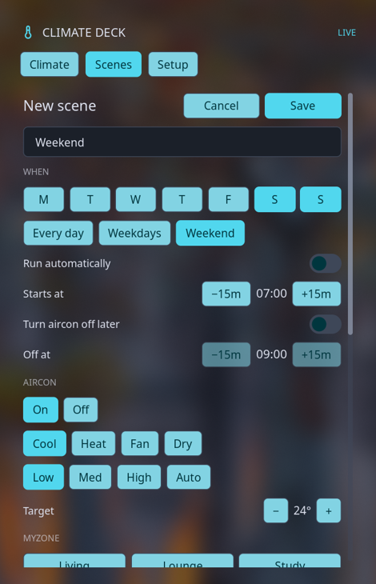

# Climate Deck for Noctalia

A native Noctalia 5 plugin for monitoring and controlling a MyPlace / MyAir ducted air conditioner over your local network. It is a port of [Climate Deck](https://github.com/xiahongze/climate-deck), using Noctalia’s own controls and theme palette. The tablet is contacted directly; no cloud account or helper daemon is needed.

The Climate page provides power, mode, fan, MyZone, zone controls and the quick timer. The Scenes page creates, edits, runs and deletes the scenes stored on the tablet. Setup provides unit and zone renaming, MyComfort controls, the MyAuto temperature range and the actual-temperature display option. History graphs are not included.



## Requirements

- Noctalia 5.0.0-beta.9 or newer (plugin API 24); tested with 5.3.0 on Niri.
- A MyPlace / MyAir / e-zone wall tablet reachable on the same network.
- The shell’s offline mode must be disabled for HTTP requests.

The Quickshell-based Noctalia Shell v4 uses a different plugin API and cannot load this plugin.

## Install

Clone this repository and run:

```sh
./scripts/install.sh
```

In Noctalia **Settings → Plugins**, open Climate Deck’s settings and enter the tablet address, for example `192.168.1.50`. Select the air conditioner and refresh interval if needed. Port 2025 is used unless a port is specified.

Add the Climate Deck bar widget through Noctalia’s bar settings or add its desktop widget through the desktop widgets editor. Click **Open controls** to open the panel. You can also open it directly:

```sh
noctalia msg panel-toggle xiahongze/climate-deck:panel
```

The installer registers this checkout as a local source. Keep the checkout in place, or add a git source instead:

```sh
noctalia msg plugins source add climate-deck git https://github.com/xiahongze/climate-deck-noctalia.git
noctalia msg plugins enable xiahongze/climate-deck
```

To find the tablet, inspect your router’s client list or see [the protocol notes](docs/API.md#finding-the-tablet). Assign a DHCP reservation so the address remains stable.

## Operation

The service polls `GET /getSystemData` without pairing parameters. Commands use the tablet’s local HTTP API and are serialized. The last reading stays visible after a failed poll; controls lock after three consecutive failures. Edits remain visible briefly while the tablet catches up and are discarded if the tablet rejects the command. The tablet runs its own quick timer and scene schedules.

To create a scene, open **Scenes → + New**, name it, choose the schedule and the aircon and zone settings, then save it. **Edit** changes an existing scene; **Delete** requires a second click. Scene names are limited to 12 characters. The editor keeps other air conditioners in a scene and leaves unrelated device groups untouched. A scene save stays open until a subsequent tablet read confirms it; an accepted command alone does not prove the tablet stored it.

Use **Setup** to rename the unit or a zone (1–12 characters; no backslash). MyAuto heat must be 16–28°C, cool must be 20–32°C, and the two must be at least 4°C apart.

MyPlace’s LAN API does not authenticate requests or encrypt them. Only use it on a network you trust. See [docs/API.md](docs/API.md) for the protocol, behavior, and attribution to the original project.

## Development

```sh
make test        # model, service, panel and catalog tests with Lua 5.4
make lint        # Noctalia plugin lint and Lua syntax checks
make package     # dist/climate-deck-noctalia.tar.gz
```

For a manual test without a real tablet, run `python3 tests/fake_tablet.py` and set the tablet address to `127.0.0.1:18765`. The fixture is redacted; the fake applies commands only to an in-memory copy, which resets when the server stops. Reset the address after testing.

## Uninstall

Disable the plugin and remove the source you added:

```sh
noctalia msg plugins disable xiahongze/climate-deck
noctalia msg plugins source remove climate-deck-local
```

Use `climate-deck` instead of `climate-deck-local` if you installed from the git source.

Not affiliated with Advantage Air. MyPlace, MyAir and e-zone are their trademarks. MIT licensed.
